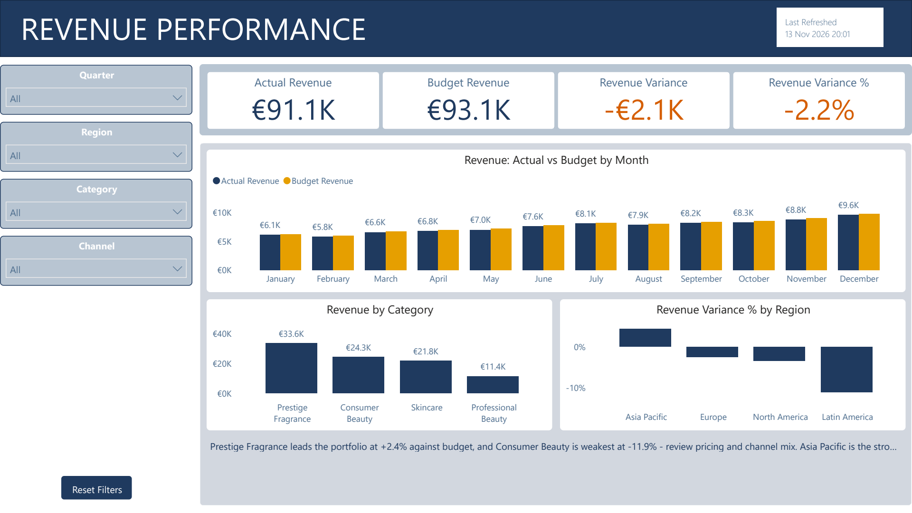
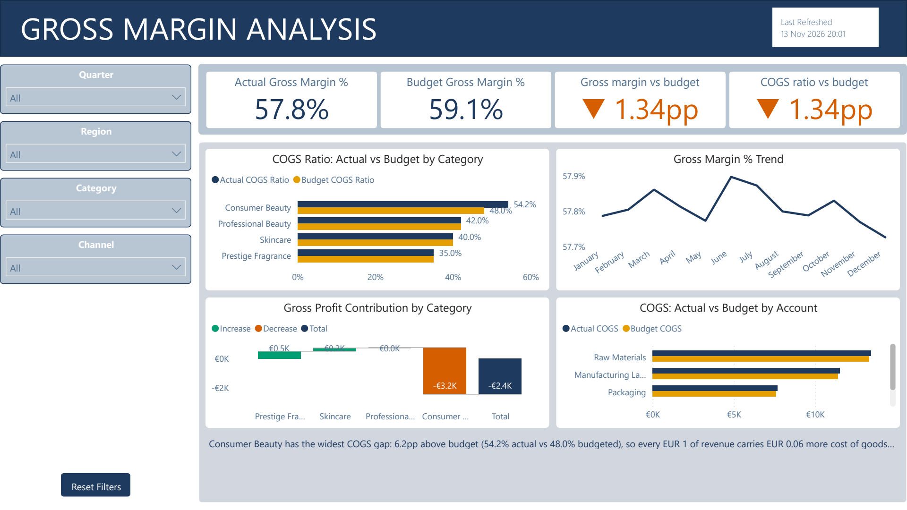
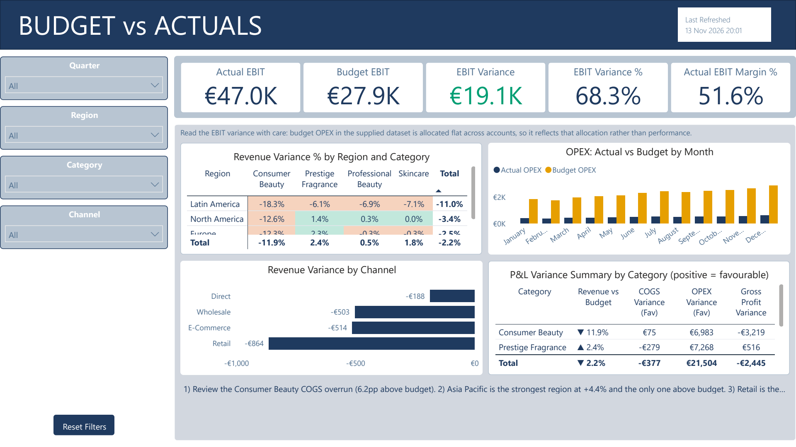
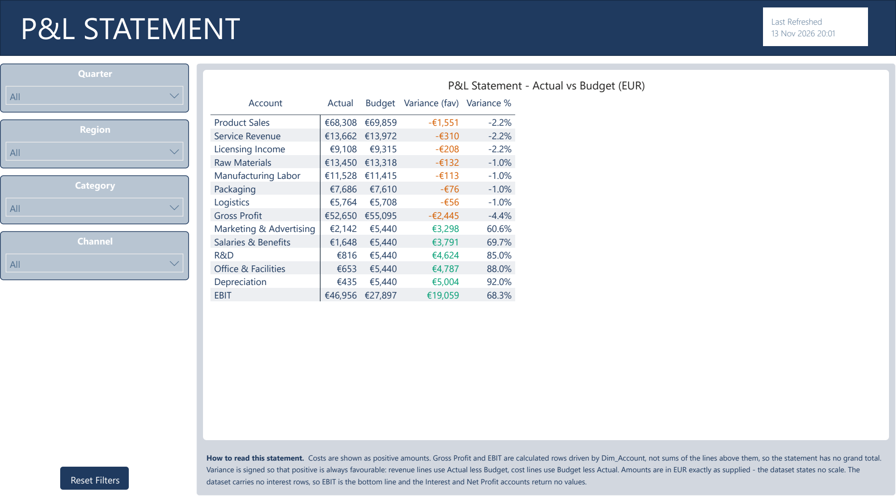

# Financial Performance (P&L)

A Power BI financial performance dashboard: revenue, gross margin, budget variance and a full
P&L statement, built on a star schema with an explicit measure layer.

Authored as a **PBIP** project — the semantic model as TMDL and the report as PBIR — so the whole
thing is plain text and reviewable in version control.

> **The data is synthetic.** It ships with the project and represents no real company. See
> [Known data caveat](#known-data-caveat) for one artefact in the figures that the report calls out
> on screen rather than hiding.

**Live report:** [Open the published report](https://app.powerbi.com/view?r=eyJrIjoiZWRiZDQzMTUtMmMxMC00MmIyLTg4YWYtOGI0Mjk4ZDc5NzYxIiwidCI6ImRmODY3OWNkLWE4MGUtNDVkOC05OWFjLWM4M2VkN2ZmOTVhMCJ9)

---

## Business question

> *We closed the year against a budget. Where did we beat the plan, where did we miss it, and
> which part of the business explains the gap?*

A monthly actual-vs-budget ledger answers that only if you can move between four altitudes without
losing the thread: the headline number, the margin that produced it, the plan variance behind it,
and the statement line where it lands. This report is built around that descent — **Revenue →
Margin → Budget vs Actuals → P&L Statement** — with one filter context carried across all four
pages, so a question asked at the top stays answered at the bottom.

---

## Pages

| Page | What it answers |
|---|---|
| **Revenue** | How does actual revenue compare with budget, by month, brand category and region? KPI row for actual, budget, variance and variance %, with a month-by-month actual-vs-budget comparison and variance by region. |
| **Margin** | Where is margin leaking? Actual vs budgeted gross margin %, the COGS ratio by category, the margin trend across the year, gross profit variance by category as a waterfall, and COGS by account. |
| **Budget vs Actuals** | Where are we against plan overall? EBIT KPI row, revenue variance % as a region × category matrix, OPEX by month, revenue variance by channel, and a variance summary by category. |
| **P&L Statement** | The statement itself: every account in P&L order with actual, budget, favourable-signed variance and variance %, with Gross Profit and EBIT as calculated rows. |

Each page carries the same four slicers — Quarter, Region, Category, Channel — a **Reset Filters**
button, and a one-line commentary that is **generated from the current filter selection** (see
[Dynamic commentary](#dynamic-commentary)).

---

## Screenshots

| | |
|---|---|
| **Revenue** — actual vs budget by month, category and region<br> | **Margin** — where margin leaks<br> |
| **Budget vs Actuals** — performance against plan<br> | **P&L Statement** — the statement itself<br> |

---

## Variance sign convention

**Positive is always favourable.** This holds for every variance measure in the model:

- revenue and profit lines use `Actual − Budget`, so beating the plan is positive
- cost lines use `Budget − Actual`, so spending under the plan is positive

Cost variances carry a `(Fav)` suffix to make that explicit: `COGS Variance (Fav)`,
`OPEX Variance (Fav)`, `COGS Ratio Variance (Fav)`. Green means favourable and orange means
unfavourable, consistently, in the KPI cards, the matrix cells and the P&L statement.

In the P&L statement the decision is driven off `Dim_Account[IsCost]`, so new cost accounts pick up
the right sign automatically.

Costs are shown as **positive amounts** throughout, as in a printed statement.

---

## Known data caveat

Budget OPEX in the supplied dataset is **allocated flat across accounts** — all five operating
expense accounts receive an identical budget total — while actual OPEX is generated with realistic
per-account weights. Actual OPEX therefore lands at roughly a fifth of budget OPEX, and the EBIT
variance that follows reflects *that allocation*, not performance.

Revenue and COGS are not affected: their actual-to-budget ratios are 0.98 and 1.01 respectively.

Rather than quietly present a large favourable EBIT variance as a result, the Budget vs Actuals page
states the caveat on the page, the generated commentary repeats it, and the `Budget OPEX`,
`Budget EBIT`, `EBIT Variance` and `EBIT Variance %` measures all carry it in their descriptions.
The source data has deliberately not been altered.

The dataset also carries **no interest rows**, so EBIT is the bottom line of this model. There are
no "Net Profit" measures; the Interest and Net Profit accounts in `Dim_Account` simply return no
values and drop out of the statement.

Amounts are in **EUR, exactly as supplied** — the dataset states no scale (thousands, millions), so
none is asserted anywhere in the report.

---

## Key techniques

**One fact table, two versions, no overlap.** `Fact_Financials` holds Actual and Budget rows side by
side, distinguished by `VersionType`. Every base measure pins both the account category and the
version in a single `CALCULATE`, so the two plans can never bleed into one another:

```dax
Actual Revenue =
CALCULATE (
    SUM ( Fact_Financials[ActualAmount] ),
    Dim_Account[AccountCategory] = "Revenue",
    Fact_Financials[VersionType] = "Actual"
)
```

**Subtotal rows driven by the dimension, not by the visual.** Gross Profit and EBIT exist as members
of `Dim_Account` carrying an `IsCalculated` flag, so the P&L matrix renders them as real rows in
`PLOrder` sequence. The measure detects which row it is on and escapes that row's own account filter
with `REMOVEFILTERS`, which is what lets a subtotal compute across the accounts above it:

```dax
P&L Actual =
VAR _cat = SELECTEDVALUE ( Dim_Account[AccountCategory] )
RETURN
    IF (
        NOT HASONEVALUE ( Dim_Account[AccountName] ),
        BLANK ( ),
        SWITCH (
            TRUE ( ),
            _cat = "Gross Profit", CALCULATE ( [Actual Gross Profit], REMOVEFILTERS ( Dim_Account ) ),
            _cat = "EBIT",         CALCULATE ( [Actual EBIT],         REMOVEFILTERS ( Dim_Account ) ),
            SELECTEDVALUE ( Dim_Account[IsCalculated] ) = TRUE ( ), BLANK ( ),
            CALCULATE (
                SUM ( Fact_Financials[ActualAmount] ),
                Fact_Financials[VersionType] = "Actual"
            )
        )
    )
```

**Sign convention as data.** Whether a variance reads `Actual − Budget` or `Budget − Actual` is a
property of the account, held in `Dim_Account[IsCost]`, not a hand-written branch per measure. Add a
cost account and it picks up the favourable sign automatically:

```dax
P&L Variance (Fav) =
VAR _a = [P&L Actual]
VAR _b = [P&L Budget]
VAR _isCost = SELECTEDVALUE ( Dim_Account[IsCost] ) = TRUE ( )
RETURN
    IF (
        ISBLANK ( _a ) && ISBLANK ( _b ),
        BLANK ( ),
        IF ( _isCost, _b - _a, _a - _b )
    )
```

**Commentary computed from the filter context.** The narrative measures rank categories and regions
inside the current selection with `ADDCOLUMNS` over `VALUES` plus `TOPN`, then compose a sentence —
and switch wording when the selection collapses to a single member, so the text never reads
"leads the portfolio" about the only thing on screen:

```dax
VAR _cats = ADDCOLUMNS ( VALUES ( Dim_Brand[Category] ), "@v", [Revenue Variance %] )
VAR _best = TOPN ( 1, _cats, [@v], DESC )
VAR _worst = TOPN ( 1, _cats, [@v], ASC )
```

These bind to **card visuals**, not text boxes, which is why they re-evaluate on every slicer move.

**Signed numerator, absolute denominator.** `ABS` on the denominator keeps the sign coming from the
variance itself, so a favourable variance against a negative budget line still reads positive:
`DIVIDE ( [P&L Variance (Fav)], ABS ( [P&L Budget] ) )`.

**Conditional colour as measures.** `Gross Margin vs Budget Colour` and `COGS Ratio vs Budget Colour`
return theme hex values bound to the visuals' conditional formatting, so favourable/unfavourable
colouring is defined once in the model rather than per visual.

Other model-level choices: a single `SourceFolder` Power Query parameter feeding all six queries,
`Dim_Date` marked as the model date table, auto date/time off, no calculated columns or tables,
measures isolated in a hidden `_Measures Table`, and a format string plus description on all 33.

---

## Model

Star schema. One fact, five conformed dimensions, five many-to-one single-direction active
relationships. No bidirectional or many-to-many relationships, no calculated columns, no row-level
security, auto date/time off.

| Table | Grain / contents |
|---|---|
| `Fact_Financials` | month × brand × region × channel × account, one row per version. Actual-version rows carry `ActualAmount`, Budget-version rows carry `BudgetAmount`, so the two never overlap. |
| `Dim_Date` | daily calendar for 2024, **marked as the model date table** on `[Date]` |
| `Dim_Account` | chart of accounts: section, statement sort order, calculated-row and cost-row flags |
| `Dim_Brand` | brand, category, launch year, price segment |
| `Dim_Region` | region, local currency, cluster, market maturity |
| `Dim_Channel` | channel, type, cost to serve |
| `Refresh Stamp` | single-row refresh timestamp (hidden) |
| `_Measures Table` | holds all 33 measures (hidden-by-convention measure table) |

Keys and raw amount columns are hidden, dimension keys are marked as primary keys, and every
measure has a format string and a description. Measures are grouped into display folders: `CORE`,
`GROSS PROFIT`, `EBIT`, `COGS RATIO`, `VARIANCE`, `KPI CARD LABELS`, `NARRATIVE`,
`P&L STATEMENT`, `UTILITY`.

The fact is monthly while the calendar is daily, so only 12 of the 366 days carry data. The calendar
is deliberately kept daily and contiguous, because that is what date-table marking and DAX time
intelligence require.

### Dynamic commentary

`Narrative Revenue`, `Narrative Margin` and `Narrative Budget vs Actuals` build their sentences in
DAX from whatever is currently selected — strongest and weakest category, leading region, largest
channel drag, the widest COGS gap — so the commentary stays true when a viewer moves a slicer. They
are bound to card visuals, not typed into text boxes.

---

## Run it locally

You need **Power BI Desktop** (any build that opens PBIP projects). Clone the repository, open
`Financial_Performance_PnL.pbip`, then point the model at your own copy of the data:

> **Transform data → Edit parameters → `SourceFolder` → the `data` folder in your
> clone → OK → Refresh.**

That is the whole setup. The rest of this section explains the parameter and offers a second way to
satisfy it that leaves the repository untouched.

The Power Query layer reads one workbook through a single `SourceFolder` parameter, committed as:

```
C:\PnL-Dashboard\data
```

That is a deliberate placeholder, not a real path on anyone's machine. Power Query cannot resolve a
path relative to the project, so the alternative would be committing an absolute path — which means
committing whoever's user name happens to be in it. Pick one of two one-time setups after cloning.

**Option A — point the placeholder at your clone (leaves the repository untouched).** Create a
directory junction, then refresh. No elevation needed, and nothing is copied:

```bat
mklink /J C:\PnL-Dashboard "<path to your clone>"
```

**Option B — edit the parameter.** **Transform data → Manage parameters → `SourceFolder`**, set it
to your clone's `data` folder, **Close & Apply**, then Refresh. Power BI writes the value into
`SemanticModel\definition\expressions.tmdl`, so this shows up as a modified file in `git status`.
Either leave it uncommitted or restore it before committing:

```bash
git restore "Financial_Performance_PnL.SemanticModel/definition/expressions.tmdl"
```

Option A keeps `git status` clean and is the better fit if you publish from this clone regularly;
Option B is more obvious to someone reading the project cold. Option A breaks if you move or rename
the clone — recreate the junction if you do.

All six queries derive their source from the parameter:

```m
Source = Excel.Workbook(File.Contents(SourceFolder & "\PnL_Dataset.xlsx"), null, true)
```

---

## Repository layout

```
Financial_Performance_PnL.pbip                 project file
Financial_Performance_PnL.SemanticModel/       model as TMDL
  definition/
    expressions.tmdl                             SourceFolder parameter
    model.tmdl, relationships.tmdl, database.tmdl
    tables/*.tmdl
Financial_Performance_PnL.Report/              report as PBIR
  definition/
    report.json, pages/pages.json
    pages/<page>/page.json
    pages/<page>/visuals/<visual>/visual.json
  StaticResources/
    RegisteredResources/NeutralCBSafe.json       report theme
    SharedResources/BaseThemes/CY19SU12.json     Power BI base theme
data/
  PnL_Dataset.xlsx                               synthetic source data
docs/
  img/*.png                                      page screenshots used in the gallery
REVIEW.md                                        design review and change log
```

---

## Theme and accessibility

The report uses a neutral, colour-blind-safe palette; five of its eight data colours come straight
from the Okabe–Ito qualitative set:

| Slot | Hex | Role |
|---|---|---|
| 0 | `#1F3A5F` | Actual series, page header, KPI card fill, titles |
| 1 | `#E69F00` | Budget series |
| 2 | `#4E6E8E` | secondary chrome |
| 3 | `#009E73` | favourable variance |
| 4 | `#D9E3EC` | card and table backgrounds |
| 5 | `#56B4E9` | additional categorical series |
| 6 | `#CC79A7` | additional categorical series |
| 7 | `#D55E00` | unfavourable variance |

Actual vs Budget reads as deep slate blue against amber — a pair that differs in both hue and
lightness, so it survives deuteranopia, protanopia, tritanopia and greyscale printing. Favourable
vs unfavourable uses the Okabe–Ito green and vermillion, which were chosen to stay separable under
red-green deficiency.

Colours come from the theme palette rather than hex literals, so re-theming the report actually
re-themes it. Every data visual carries alt text.

---

## Checks

The model is kept clean against the Tabular Editor **Best Practice Analyzer**. The remaining
findings are all deliberate and are listed at the end of `REVIEW.md`, together with the independent
recomputation of every KPI from the source workbook.
